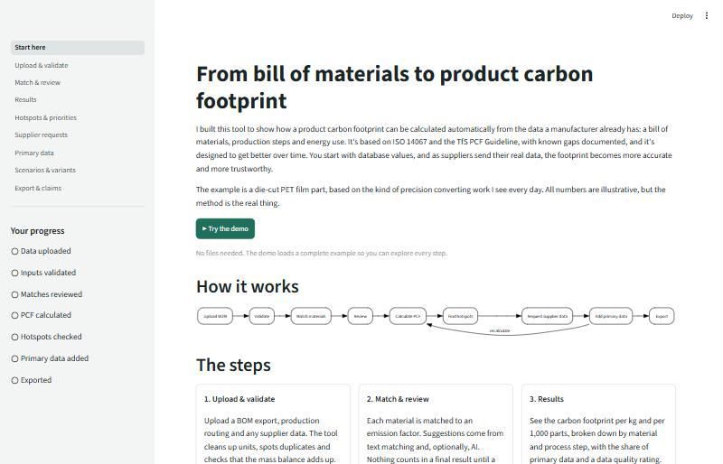
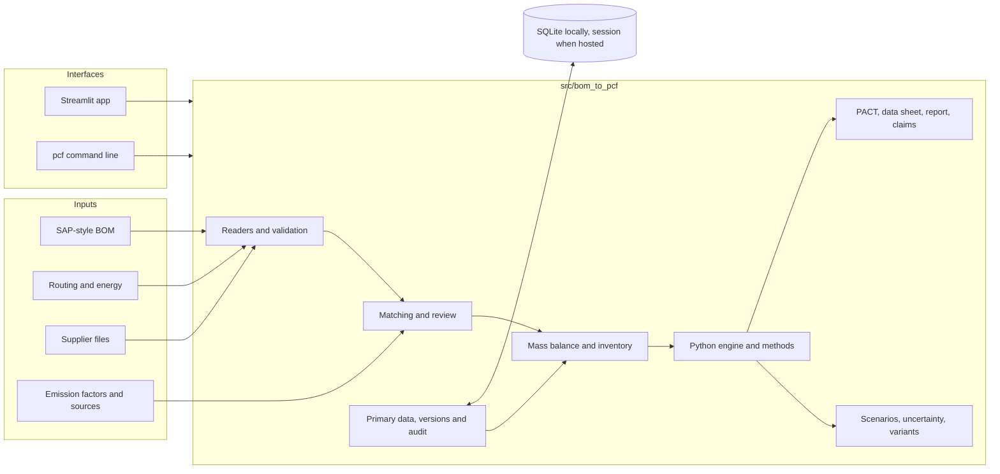
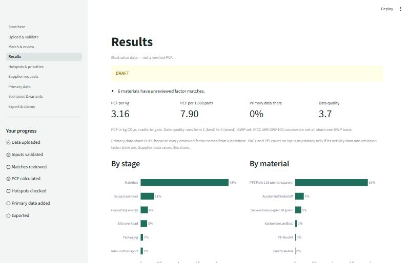
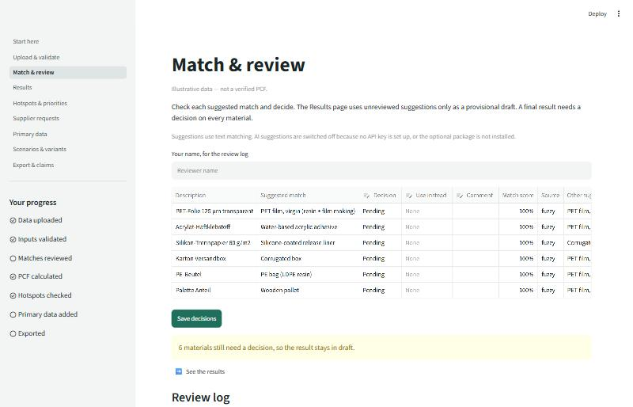
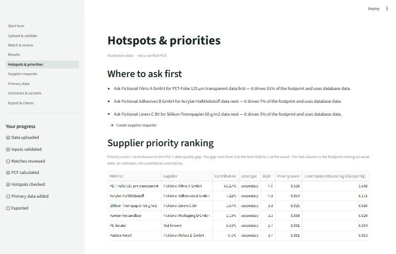
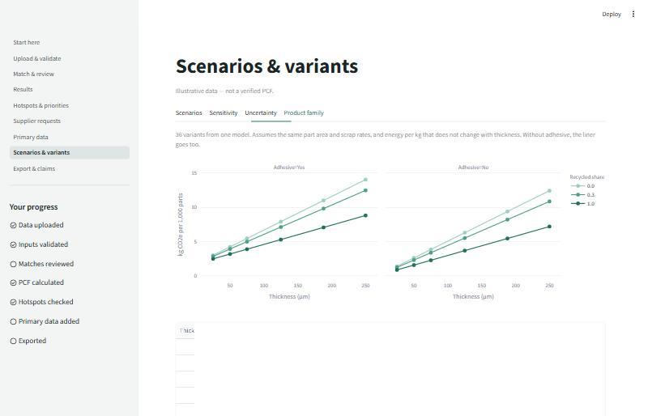
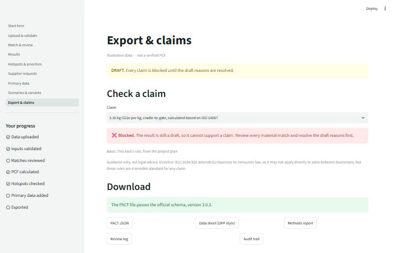

# bom-to-pcf

This tool calculates a cradle-to-gate product carbon footprint (PCF) from a bill of materials, production
steps and energy use, then updates it as suppliers send real data.

> Everything here is illustrative. The data is representative, the supplier names are fictional, and no real
> company's data is used. This is not a verified PCF, so please don't use it for real claims.

**Live app:** link to be added after deployment



## The problem

Customers keep asking for product carbon footprints, and the inputs are scattered across BOM exports, machine
data and supplier emails. Done by hand, the work is slow and hard to repeat. It's also easy to lose track of how
much of the answer is just a generic database value.

## The approach

1. Clean a SAP-style BOM export (German decimals, mixed units, duplicates, missing suppliers) and check the
   mass balance.
2. Suggest an emission factor for each material using text matching and, optionally, AI. A person decides each
   one, and the result stays a draft until they have.
3. Calculate the PCF per kg and per 1,000 parts, with primary data share and data quality rating. You can trace
   any line back to its factor and source.
4. Rank suppliers by how much they contribute and how weak their data is.
5. Create data requests, then check incoming supplier PCFs before they replace database values. Every change
   is logged and can be undone.
6. Try scenarios, sensitivity, Monte Carlo and a 36-variant product family, check environmental claims, and
   export PACT JSON, a data sheet and a methods report.

## Architecture



The calculations are all in `src/`, and the app's pages only call them. Parameters are in YAML and factors are
in CSV.

## Screenshots

| | |
|---|---|
|  **Results** with status, data quality and breakdowns |  **Match & review** with a person deciding each match |
|  **Hotspots** ranking which supplier to ask first |  **Product family** of 36 variants from one model |
|  **Export & claims** with a draft blocking claims | |

## How it maps to the standards and requirements

| Requirement | How the project shows it | How far it goes |
|---|---|---|
| ISO 14067, ISO 14040/44 | Goal and scope, boundary, allocation, cut-off, data quality | Framework only. These paid standards were not read, so no clauses are cited |
| TfS PCF Guideline 3.0, PACT Methodology 3.0 | Primary data share, DQR, exclusions and waste follow them, with sections cited | [Known differences](docs/data_gaps.md) remain, such as electricity method |
| GHG Protocol Product Standard | Named as the framework | Not read directly |
| BOM, ERP and supplier data | Mock SAP-style export and supplier PCF files | Mock files, not a live connection |
| Supplier PCFs, Scope 3.1 | Priority ranking, data requests, tracker, primary data replacement | Requests are created, never sent |
| Mass and energy balance, LCI | Per-step inventory with an automatic check | Mock process data |
| Parameterised, scalable models | YAML scenarios, sensitivity, batch variants | Variants assume constant part area and scrap rates |
| Python and APIs | Pure-Python engine | The optional openLCA backend is not built |
| AI with expert validation | Optional matching with human approval and a log | Tested against a simulated API only |
| PACT data exchange | JSON validated against the official schema, version 3.0.3 | Valid structure, with some fields [limited by the data](docs/data_gaps.md) |
| ESPR, Digital Product Passport | A passport-style data sheet | Not a passport under the ESPR |
| Credible environmental claims | Checks claims against Directive (EU) 2024/825 | [Guidance only](docs/claims_check.md), not legal advice |

## Limitations

The data is mock, and some factors are poor fits. Two are proxies I calculated, and the PET resin figure is
from the US. [data_gaps.md](docs/data_gaps.md) has the full list.

The demo starts as a draft with 0% primary data. That's correct under PACT and TfS, because every emission
factor comes from a database. Supplier data raises it.

The sources don't share one IPCC report, so values are used as published. The Monte Carlo spreads are my own
assumptions based on quality scores, not published values. Each material can only have one supplier value, so
dual sourcing isn't modelled.

This project doesn't cover real company data, third-party verification, certified EPD or PCF claims, a full ISO
14044 critical review, emailing suppliers, user accounts, other languages, product-specific ESPR requirements
or legal advice.

## How to run

You need Python 3.11 or newer.

```bash
git clone https://github.com/joenewton10/bom-to-pcf.git
cd bom-to-pcf
python -m venv .venv
```

Activate it with `.venv\Scripts\activate` on Windows, or `source .venv/bin/activate` on macOS and Linux.

```bash
pip install -e ".[dev]"
streamlit run app/Home.py
```

Then click **Try the demo**. Locally, your work is saved in `data/app.db`. To begin again, use **Start fresh**
at the bottom of the Primary data page.

Optional AI suggestions need `pip install -e ".[llm]"` and an `ANTHROPIC_API_KEY`.

### Command line

```bash
pcf validate-inputs --product config/product_pet_diecut.yaml
pcf run --product config/product_pet_diecut.yaml --scenario green_electricity
pcf variants --config config/variants_pet_family.yaml
pcf export-pact --run-id <id printed by pcf run>
```

### Checks

```bash
ruff check .
pytest
```

## Documentation

[Methodology](docs/methodology.md) · [Data gaps](docs/data_gaps.md) · [AI validation](docs/ai_validation.md) ·
[Primary data workflow](docs/primary_data_workflow.md) · [Claims check](docs/claims_check.md) ·
[Regulatory context](docs/regulatory_context.md) · [Example outputs](outputs/examples) ·
[Project plan](PROJECT_PLAN.md) · [Changelog](CHANGELOG.md)

The PACT schema in `schemas/pact/` comes from the WBCSD
[data-exchange-protocol](https://github.com/wbcsd/data-exchange-protocol) repository, tag `v3.0.3`.

Built by Joseph Newton · [GitHub](https://github.com/joenewton10) · [joenewton10.github.io](https://joenewton10.github.io)
